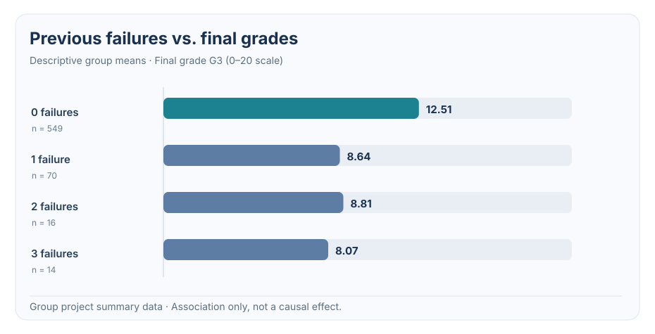

# Factors Influencing Student Academic Performance

**R · Statistical Analysis · Regression · ANOVA · Exploratory Data Analysis**

> **Research question:** How are school-choice reasons, previous class failures, and urban/rural residence associated with final secondary-school grades?

*Figure: descriptive group means documented in the original team report. It illustrates an association, not the causal effect of past failures.*

## Project snapshot

| | |
| --- | --- |
| **Dataset** | [UCI Student Performance](https://archive.ics.uci.edu/dataset/320/student+performance), Portuguese-language course |
| **Size** | 649 students, 33 variables |
| **Outcome** | `G3`, final grade on a 0–20 scale |
| **Methods** | EDA, linear regression, ANOVA, statistical tests and diagnostic plots |
| **Tools** | R, ggplot2, Quarto |
| **Format** | Team research project (Applied Statistics, Trent University) |

## Selected findings

The summary in the original course documentation reports these **descriptive associations**:

- **Previous failures:** Students with zero recorded class failures had a mean final grade of **12.51**, compared with **8.64** among students with one failure. Groups with two or three failures were much smaller, so comparisons should be treated cautiously.
- **Reason for choosing a school:** The reported mean final grades varied across school-choice categories, with the reputation group showing a mean of **12.94** and the other-reasons group **10.69**.
- **Urban vs. rural residence:** Mean final grades were approximately **12.3** (urban) and **11.1** (rural) in the reported EDA.

These differences are **not evidence of causation**. The project also examined regression assumptions and differences across groups; some modeling results used exclusions documented in the full report.

## My contribution & team credits

This was a **group project** completed with **Feng Qiu** and **Keyao Li**.

My assigned analytical focus was the variable **`failures`**. My contributions documented in the project log included EDA for this variable, simple linear regression, ANOVA, associated interpretation and participation in the methodology framework. Team contributions should not be interpreted as work completed individually.

## Explore the work

| Resource | Description |
| --- | --- |
| [Analysis source (Quarto)](./Group6_5240H_Project.qmd) | Reproducible R/Quarto analysis code |
| [Full project report (PDF)](./Group6_5240H_Project.pdf) | Detailed methodology, results and diagnostics |
| [Sample dataset](./student-por.csv) | UCI Portuguese-course student performance data |
| [Original course project documentation](./docs/original-course-readme.md) | Full work log, course milestones and collaborator assignments |
| [Vietnamese documentation](./README.vi.md) | Original expanded notes in Vietnamese |
| [Chinese documentation](./README.zh.md) | Original expanded notes in Chinese |

## Interpretation and limitations

This is an observational educational dataset. Group sizes vary substantially, particularly among students with multiple past failures; regression and group comparisons depend on assumptions, treatment of zero grades, and measured covariates. The reported differences are descriptive and should not be turned into causal claims or individual predictions.

**Data source:** P. Cortez and A. Silva (2008), available through the [UCI Machine Learning Repository](https://archive.ics.uci.edu/dataset/320/student+performance). Follow the dataset's stated reuse and attribution terms.

---

[Back to Data Analyst portfolio](https://github.com/vyhuynh071200)
